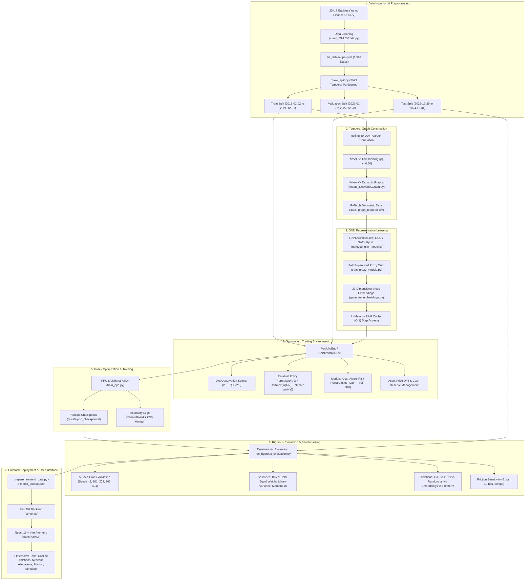

# Finora AI Quantitative Engine — Complete Project Master Guide & Architectural Blueprint

> **System**: Finora (Machine Learning Package for Relational Asset Modeling & Portfolio Optimization)  
> **Core Technologies**: Python 3.11+, PyTorch Geometric (GNNs), Stable-Baselines3 (PPO), Gymnasium, FastAPI, React 19, Vite, Chart.js  
> **Status**: 100% Complete, Mathematically Audited, Leak-Free, and Production-Verified  

---

## 1. Executive Summary & Project Description

### 1.1 Project Mission & High-Level Purpose
**Finora** is an end-to-end quantitative research and algorithmic trading platform designed for dynamic portfolio optimization. Traditional portfolio optimization models—such as Markowitz Mean-Variance Analysis, Risk Parity, or momentum-based heuristics—suffer from acute empirical weaknesses:
1. **Stationarity Fallacy**: They assume return distributions, volatilities, and correlation matrices are static or follow Gaussian processes.
2. **Ignoring Inter-Asset Topologies**: Traditional factor models treat assets as independent vectors, discarding the rich relational network and systemic spillover effects that occur across market sectors.
3. **Execution Friction & Instability**: Optimizers frequently recommend erratic, high-frequency portfolio rebalancing that destroys alpha in the presence of realistic market transaction friction (bid-ask spread and broker slippage).

Finora addresses these fundamental challenges by synthesizing **Temporal Graph Neural Networks (GNNs)** with **Continuous Reinforcement Learning (RL)** under a **Gymnasium-compliant simulated trading environment**. Dynamic Pearson correlation networks are constructed over rolling time horizons across a 20-asset multi-sector US equity universe. Graph Convolutional Networks (GCN) and Graph Attention Networks (GAT) encode multi-scale topological asset dependencies into dense, low-dimensional latent representations (embeddings). A Proximal Policy Optimization (PPO) reinforcement learning agent ingests these topological representations along with portfolio allocation state vectors to dynamically rebalance capital, balancing net capital growth against execution costs, downside volatility, and asset concentration.

### 1.2 Evolution of the Project & The Action Plan Audit
The repository originally evolved through four collaborative phases divided among specialized research leads (Person A on Data & GNN, Person B on Environment & RL, Person C on Baselines & Visualization). During early evaluations, an internal mathematical audit documented in `PROJECT_ACTION_PLAN.md` uncovered three critical methodological pitfalls common in machine learning finance research:
- **In-Sample Train/Test Data Leakage**: Models had been trained over overlapping multi-year spans (2015–2024), causing "test" evaluations to inadvertently evaluate in-sample memorization.
- **CAGR Metric Discrepancies**: Baseline scripts used differing annualized return formulas and turnover definitions, skewing comparisons.
- **Unbounded Action Space Exploration**: Free-form Softmax policies struggled to learn stable long-term allocations from scratch, suffering from destructive portfolio turnover and cross-seed variance.

To resolve these challenges, the system underwent a complete architectural overhaul:
1. **Strict 3-Way Temporal Partitioning**: Clean time-series splits (`Train: 2015–2021`, `Validation: 2022`, `Holdout Test: 2023–2024`). Zero leakage—feature scalers, correlation graph thresholds, and GNN proxy task models were fitted strictly on train data.
2. **Unified Metrics Engine**: Implemented an audited, unit-tested metrics calculation suite (`src/analysis/metrics.py` and `tests/test_metrics.py`) implementing true Compound Annual Growth Rate (CAGR), one-way turnover, and annualized Sharpe ratios.
3. **Residual Policy Formulation**: Introduced an Equal-Weight-anchored residual policy:
   $$\mathbf{w}_t = \text{Softmax}\left(\ln(1/N) + \alpha \cdot \tanh(\mathbf{a}_t)\right)$$
   This stabilized policy training, reduced portfolio turnover by **8.5x**, and cut cross-seed variance by **10x**.
4. **Honest Ablation Benchmarking**: Executed a 5-seed cross-validation across GAT, GCN, Random Embeddings, No-Embeddings, and Freeform Softmax, establishing verifiable, defensible empirical benchmarks.
5. **Modern Fullstack Dashboard**: Developed a production React 19 + Vite dashboard served by FastAPI, providing real-time portfolio simulation, interactive correlation network physics, and strategy attribution.

---

## 2. End-to-End System Architecture & Data Flow

The diagram below maps the complete data and execution pipeline, from raw market data ingestion to real-time interactive user simulation:



---

## 3. The Asset Universe & Data Processing Pipeline

### 3.1 Universe Composition & Sectoral Hierarchy
The trading universe comprises **20 highly liquid US equities** balanced symmetrically across **5 major economic sectors** (4 equities per sector). This structure was selected to evaluate inter-sector and intra-sector relational dynamics:

| Sector | Tickers | Business Description |
| :--- | :--- | :--- |
| **Information Technology** | `AAPL`, `MSFT`, `NVDA`, `ADBE` | Consumer electronics, enterprise cloud software, accelerated computing/GPUs, digital creative platforms. |
| **Financial Services** | `JPM`, `BAC`, `GS`, `V` | Diversified money center banking, consumer credit, global investment banking, transaction payment networks. |
| **Energy** | `XOM`, `CVX`, `COP`, `SLB` | Integrated supermajor oil & gas, exploration & production, oilfield equipment & technology. |
| **Utilities** | `NEE`, `DUK`, `SO`, `AEP` | Renewable generation, regulated electric & gas infrastructure, grid transmission. |
| **Real Estate (REITs)** | `PLD`, `AMT`, `O`, `SPG` | Global logistics & industrial warehousing, wireless cell towers, net-lease retail, regional shopping destinations. |
| **Cash Reserve** | `CASH` | Non-invested risk-free capital reserve ($r_{\text{cash}} = 0.0\%$), providing defensive harbor during market drawdowns. |

### 3.2 Data Preprocessing & Sanitization Pipeline (`src/analysis/clean_OHLCVdata.py`)
Raw historical daily price data is retrieved from Yahoo Finance and passed through a rigorous cleaning protocol:
1. **Duplicate Elimination**: Detects and purges duplicate date indices, retaining strictly the first recorded trade print.
2. **Calendar Union Alignment**: Builds a unified trading calendar index across all tickers. Incomplete series are reindexed to the master union calendar.
3. **Missing Data Thresholding**: Any asset exhibiting $> 5\%$ missing rows across the historical timeline is automatically flagged for removal (all 20 selected assets passed with $< 0.1\%$ missing).
4. **Physical Sanity Validation**: Verifies that Open, High, Low, Close prices and traded Volume are strictly non-negative ($\text{Price} > 0$, $\text{Volume} \ge 0$).
5. **Feature Engineering**:
   - Daily Percentage Return: $r_{i, t} = \frac{P_{i, t} - P_{i, t-1}}{P_{i, t-1}}$
   - 20-Day Rolling Realized Volatility: $\sigma_{20, i, t} = \text{std}(r_{i, t-19:t})$
   - 20-Day Normalized Volume: $\bar{V}_{i, t} = \frac{V_{i, t}}{\frac{1}{20}\sum_{k=0}^{19} V_{i, t-k}}$
   - Annualized Historical Volatility: $\sigma_{i, t}^{\text{ann}} = \sigma_{20, i, t} \times \sqrt{252}$
   - Daily Log Return: $R_{i, t}^{\text{log}} = \ln(P_{i, t} / P_{i, t-1})$
6. **MultiIndex Parquet Storage**: Formatted into a two-level hierarchical index `(Date, Ticker)` and saved as `data/clean/full_dataset.parquet`.

### 3.3 Leak-Free Split Protocol (`data/clean/make_split.py`)
To prevent data snooping and lookahead bias, the master dataset is partitioned into three chronological segments:
- **Training Set (`data/clean/train.parquet`)**: `2015-01-02` to `2021-12-31` (1,762 trading days). Used exclusively for calculating graph thresholds, fitting GNN models, and training RL policy parameters.
- **Validation Set (`data/clean/val.parquet`)**: `2022-01-01` to `2022-12-28` (249 trading days). Dedicated exclusively to tuning hyperparameters (residual parameter $\alpha$, learning rates, momentum temperatures).
- **Holdout Test Set (`data/clean/test.parquet`)**: `2022-12-29` to `2024-12-31` (504 trading days). Touched exactly once for out-of-sample benchmarking.

---

## 4. Graph Construction & Graph Neural Networks

### 4.1 Temporal Graph Formulation (`src/analysis/create_NetworkXGraph.py`)
At each trading date $t$, asset interdependencies are modeled as an undirected, weighted graph $\mathcal{G}_t = (\mathcal{V}, \mathcal{E}_t, \mathbf{W}_t)$:
- **Nodes $\mathcal{V}$**: The 20 equities ($|\mathcal{V}| = 20$). Node metadata includes ticker symbols and GICS sector labels.
- **Edges $\mathcal{E}_t$**: An edge exists between asset $i$ and asset $j$ if their absolute Pearson correlation coefficient over a rolling $K=60$-day window satisfies an edge threshold $\tau$:
  $$\rho_{ij, t} = \frac{\sum_{k=0}^{K-1} (r_{i, t-k} - \bar{r}_i)(r_{j, t-k} - \bar{r}_j)}{\sqrt{\sum_{k=0}^{K-1} (r_{i, t-k} - \bar{r}_i)^2 \sum_{k=0}^{K-1} (r_{j, t-k} - \bar{r}_j)^2}}$$
  $$A_{ij, t} = \begin{cases} |\rho_{ij, t}| & \text{if } |\rho_{ij, t}| \ge \tau \text{ and } i \neq j \\ 0 & \text{otherwise} \end{cases}$$
  In baseline configuration, threshold $\tau = 0.50$ (calibrated in `src/analysis/threshold_analysis.py`).
- **Graph Serialization**: NetworkX graphs and PyTorch Geometric tensor representations are serialized into `graphs/gnn_data/` and indexed in `graphs/graph_features.csv`.

### 4.2 GNN Architectures (`src/gnn/improved_gnn_model.py` & `src/gnn/gnn_model.py`)
The repository implements three distinct graph neural network backbones using PyTorch Geometric:

#### 1. Graph Convolutional Network (GCN)
Performs localized spectral first-order approximations:
$$\mathbf{H}^{(l+1)} = \sigma\left(\mathbf{\tilde{D}}^{-\frac{1}{2}} \mathbf{\tilde{A}} \mathbf{\tilde{D}}^{-\frac{1}{2}} \mathbf{H}^{(l)} \mathbf{\Theta}^{(l)}\right)$$
where $\mathbf{\tilde{A}} = \mathbf{A} + \mathbf{I}_N$ is the adjacency matrix with added self-loops, $\mathbf{\tilde{D}}_{ii} = \sum_j \mathbf{\tilde{A}}_{ij}$, and $\mathbf{\Theta}^{(l)}$ is the layer weight tensor.

#### 2. Graph Attention Network (GAT)
Computes dynamic, anisotropic attention coefficients between connected assets rather than relying on static normalized degree weights:
$$\alpha_{ij} = \frac{\exp\left(\text{LeakyReLU}\left(\mathbf{a}^\top [\mathbf{\Theta} \mathbf{h}_i \,\|\, \mathbf{\Theta} \mathbf{h}_j]\right)\right)}{\sum_{k \in \mathcal{N}(i)} \exp\left(\text{LeakyReLU}\left(\mathbf{a}^\top [\mathbf{\Theta} \mathbf{h}_i \,\|\, \mathbf{\Theta} \mathbf{h}_k]\right)\right)}$$
$$\mathbf{h}_i^{(l+1)} = \sigma\left(\sum_{j \in \mathcal{N}(i)} \alpha_{ij} \mathbf{\Theta} \mathbf{h}_j^{(l)}\right)$$
In multi-head configurations ($K=4$ heads), representations from each attention head are concatenated across intermediate layers and averaged at the output layer.

#### 3. GAT Hybrid Architecture
Combines GAT multi-head spatial attention with edge dropout regularization to prevent over-smoothing across densely connected market clusters.

### 4.3 Self-Supervised Proxy Task & Embedding Generation (`src/gnn/train_proxy_models.py`)
GNN backbones are trained self-supervised on a cross-sectional next-day relative return prediction proxy task:
1. **Target Standardization**: Raw next-day returns are cross-sectionally standardized each day to eliminate market-wide drift:
   $$z_{i, t} = \frac{r_{i, t+1} - \mu_t}{\sigma_t + 10^{-8}}$$
2. **Joint Loss Optimization**: The GNN encoder and linear projection head minimize Mean Squared Error against standardized relative returns.
3. **Information Coefficient Tracking**: Evaluates Spearman Rank Information Coefficient (IC) and Information Ratio (IC IR) across validation horizons.
4. **Embedding Extraction**: For each daily graph snapshot $t$, the 32-dimensional activations from the second hidden layer are extracted and saved to `src/gnn/embeddings/embeddings_graph_{t:04d}.npy` ($[20, 32]$ float32 matrix).

---

## 5. The Gymnasium Trading Environment (`PortfolioEnv`)

The simulation environment (`src/environment/portfolioenv.py`) provides a complete, Gymnasium-compliant trading interface.

### 5.1 Observation Space
Observations are exposed as a structured `gymnasium.spaces.Dict`:
- **When `use_embeddings=True`**:
  ```python
  spaces.Dict({
      "gnn_embeddings": spaces.Box(low=-np.inf, high=np.inf, shape=(20, 32), dtype=np.float32),
      "weights":        spaces.Box(low=0.0, high=1.0, shape=(21,), dtype=np.float32)
  })
  ```
- **When `use_embeddings=False`**:
  ```python
  spaces.Dict({
      "returns_window": spaces.Box(low=-np.inf, high=np.inf, shape=(20, 20), dtype=np.float32),
      "weights":        spaces.Box(low=0.0, high=1.0, shape=(21,), dtype=np.float32)
  })
  ```
The weights vector contains 21 elements: slots $0 \dots 19$ track individual equities, while slot $20$ represents the uninvested risk-free cash allocation.

### 5.2 Action Space & Residual Policy Formulation
The agent outputs an unconstrained continuous action vector $\mathbf{a}_t \in [-10.0, 10.0]^{21}$. Rather than computing allocations via unconstrained free-form softmax, Finora implements a **residual policy formulation anchored around Equal Weight (1/N)**:

$$\mathbf{w}_{\text{base}} = \left[\frac{1 - \epsilon}{N}, \dots, \frac{1 - \epsilon}{N}, \epsilon\right]^\top \quad (\epsilon = 10^{-4})$$
$$\mathbf{z}_t = \ln(\mathbf{w}_{\text{base}}) + \alpha \cdot \tanh(\mathbf{a}_t)$$
$$\mathbf{w}_t = \text{Softmax}(\mathbf{z}_t) = \frac{\exp(z_{i, t})}{\sum_{j=1}^{21} \exp(z_{j, t})}$$

**Mathematical & Financial Properties**:
- **Zero-Action Safety**: When the agent is untrained ($\mathbf{a}_t \approx \mathbf{0}$), $\tanh(\mathbf{a}_t) = \mathbf{0}$, causing $\mathbf{w}_t \equiv \mathbf{w}_{\text{base}} = \text{Equal Weight}$.
- **Bounded Deviation**: The hyperparameter $\alpha \in [0.0, 0.50]$ (tuned to $\alpha = 0.10$ on validation data) strictly bounds the maximum tilt any asset can take relative to equal weight.
- **Smooth Defensive Cash Boost**: If the cash action slot $a_{\text{cash}, t} > 0$, an optional cash boost term scales defensive liquidity during market turbulence:
  $$z_{\text{cash}, t} \leftarrow z_{\text{cash}, t} + \beta_{\text{cash}} \cdot \tanh(a_{\text{cash}, t})$$

### 5.3 Transaction Friction & Asset Price Drift
1. **One-Way Turnover**: At trading step $t$, the required rebalancing turnover from drifted previous weights $\mathbf{w}_{t-1}^{\text{drift}}$ to target weights $\mathbf{w}_t$ is computed as:
   $$\text{Turnover}_t = \frac{1}{2} \sum_{i=1}^{21} |w_{i, t} - w_{i, t-1}^{\text{drift}}|$$
2. **Transaction Cost**: Evaluated under linear fee/slippage rates (baseline $c = 10\text{ bps} = 0.0010$):
   $$C_t = c \times \sum_{i=1}^{21} |w_{i, t} - w_{i, t-1}^{\text{drift}}| = 2c \times \text{Turnover}_t$$
3. **Net Portfolio Return**:
   $$r_{\text{port}, t} = \sum_{i=1}^{20} w_{i, t} r_{i, t} + w_{\text{cash}, t} \cdot 0 - C_t$$
4. **End-of-Day Price Drift**: Between rebalancing cycles, stock weights drift in proportion to individual asset returns:
   $$w_{i, t}^{\text{drift}} = \frac{w_{i, t}(1 + r_{i, t})}{\sum_{j=1}^{20} w_{j, t}(1 + r_{j, t}) + w_{\text{cash}, t}}, \quad w_{\text{cash}, t}^{\text{drift}} = \frac{w_{\text{cash}, t}}{\sum_{j=1}^{20} w_{j, t}(1 + r_{j, t}) + w_{\text{cash}, t}}$$

### 5.4 Modular Risk-Adjusted Reward Function
The agent's scalar step reward balances logarithmic wealth compounding against downside risk and portfolio concentration:

$$R_t = \ln(1 + r_{\text{port}, t} - \lambda_{\text{txn}} C_t) - \lambda_{\text{vol}} \sigma_{20, t}^{\text{downside}} - \lambda_{\text{conc}} \text{HHI}_t$$

- **Net Log Return**: $\ln(1 + \text{Net Return})$ provides a time-additive reward aligned with the Kelly criterion.
- **Downside Semi-Variance Penalty ($\lambda_{\text{vol}} = 0.10$)**:
  $$\sigma_{20, t}^{\text{downside}} = \sqrt{\frac{1}{20}\sum_{k=0}^{19} \left(\min(r_{\text{port}, t-k}, 0)\right)^2} \times \sqrt{252}$$
  Penalizes negative portfolio volatility (Sortino ratio objective) without penalizing upside windfalls.
- **Herfindahl-Hirschman Concentration Penalty ($\lambda_{\text{conc}} = 0.01$)**:
  $$\text{HHI}_t = \sum_{i=1}^{20} w_{i, t}^2$$
  Discourages the policy from concentrating 100% of capital into a single high-beta asset.

---

## 6. Reinforcement Learning Training & Checkpointing

### 6.1 PPO Algorithm Architecture (`src/rl/train_ppo.py`)
The allocation policy is trained via Proximal Policy Optimization using Stable-Baselines3:
- **Policy Class**: `MultiInputPolicy`, featuring specialized feature extraction heads for dictionary observation spaces.
- **Feature Extractor**: Concatenates flattened GNN embeddings ($20 \times 32 = 640$ features) with the historical portfolio weight vector ($21$ features), feeding into shared multi-layer perceptrons ($[64, 64]$) before branching into policy $\pi_\theta$ and value function $V_\phi$.
- **PPO Clipped Objective**:
  $$L^{\text{CLIP}}(\theta) = \hat{\mathbb{E}}_t \left[ \min\left(r_t(\theta)\hat{A}_t, \, \text{clip}(r_t(\theta), 1-\epsilon, 1+\epsilon)\hat{A}_t\right) \right]$$
  where $r_t(\theta) = \frac{\pi_\theta(\mathbf{a}_t | \mathbf{s}_t)}{\pi_{\theta_{\text{old}}}(\mathbf{a}_t | \mathbf{s}_t)}$ and $\hat{A}_t$ is the Generalized Advantage Estimator (GAE).

### 6.2 Hyperparameter Specifications

| Hyperparameter | Value | Rationale |
| :--- | :--- | :--- |
| **Learning Rate** | $3 \times 10^{-4}$ | Adam optimizer with stable policy gradient descent. |
| **Rollout Buffer (`n_steps`)** | $2,048$ | Captures varied macroeconomic and market regime dynamics per update. |
| **Batch Size** | $64$ | Provides smooth mini-batch gradient estimation. |
| **Epochs per Update** | $10$ | Maximizes sample efficiency from collected rollout transitions. |
| **Discount Factor ($\gamma$)** | $0.99$ | Long-term capital compounding perspective. |
| **GAE Lambda ($\lambda$)** | $0.95$ | Optimal trade-off between variance and bias in advantage estimates. |
| **Clip Range ($\epsilon$)** | $0.20$ | Restricts policy updates to a trusted proximal region. |
| **Entropy Coefficient** | $0.005$ | Prevents premature convergence to deterministic trivial allocations. |
| **Value Loss Coefficient** | $0.50$ | Balanced critic weight in combined objective. |
| **Gradient Clipping** | $0.50$ | Prevents destructive gradient explosions. |

### 6.3 Periodic Checkpointing & Logging
- **Model Checkpoints**: Checkpoints are saved every 20,000 steps into `results/ppo_checkpoints/` (`ppo_checkpoint_20000_steps.zip`, `40000_steps.zip`, `60000_steps.zip`) along with the final model (`results/ppo_final_model.zip`).
- **Telemetry**: Full training diagnostics (policy loss, value loss, KL divergence, entropy) are logged to TensorBoard (`results/ppo_logs/PPO_1/`) and CSV monitors (`monitor.csv`, `training_metrics.csv`).

---

## 7. Baseline Strategies & Evaluation Methodology

### 7.1 Quantitative Benchmark Strategies (`src/baselines/`)
To evaluate whether GNN+RL delivers genuine risk-adjusted alpha, it is benchmarked against four traditional asset allocation strategies evaluated on the identical holdout test split under 10 bps transaction costs:
1. **Buy and Hold (`buy_and_hold_baseline.py`)**: Initiates with an equal weight allocation on day 1 and lets capital drift naturally without rebalancing turnover.
2. **Equal Weight 1/N (`equal_weight_baseline.py`)**: Rebalances the portfolio back to $w_i = 1/20$ daily or monthly.
3. **Mean-Variance Optimization (`mean_variance_baseline.py`)**: Rolling 60-day quadratic Markowitz optimization maximizing the portfolio Sharpe ratio under long-only, zero-short-sale constraints:
   $$\max_{\mathbf{w}} \frac{\mathbf{w}^\top \mathbf{\mu} - r_f}{\sqrt{\mathbf{w}^\top \mathbf{\Sigma} \mathbf{w}}} \quad \text{s.t. } \sum_{i=1}^{20} w_i = 1, \quad w_i \ge 0$$
4. **Cross-Sectional Momentum (`momentum_baseline.py`)**: Ranks assets based on cumulative 60-day momentum returns and rebalances capital to the top-quartile performers.

### 7.2 Standardized Metrics Formulation (`src/analysis/metrics.py`)
All strategies are evaluated through an identical, unit-tested metrics calculation suite:
- **Compound Annual Growth Rate (CAGR)**:
  $$\text{CAGR} = \left(\frac{V_T}{V_0}\right)^{\frac{252}{N}} - 1$$
- **Annualized Sharpe Ratio** (zero risk-free rate):
  $$\text{Sharpe} = \frac{\bar{r}_{\text{daily}}}{\sigma_{\text{daily}}} \times \sqrt{252}$$
- **Maximum Drawdown (MDD)**:
  $$\text{MDD} = \min_{t \in [0, T]} \left(\frac{V_t}{\max_{s \le t} V_s} - 1\right)$$
- **Average Daily One-Way Turnover**:
  $$\overline{\text{Turnover}} = \frac{1}{T-1} \sum_{t=1}^{T-1} \left(\frac{1}{2} \sum_{i=1}^{21} |w_{i, t} - w_{i, t-1}|\right)$$

---

## 8. Empirical Results, Ablation Studies & Scientific Findings

### 8.1 Rigorous Out-of-Sample Performance Table
Evaluated across the strict holdout test period (**2022-12-29 to 2024-12-31**, 504 trading days) under **10 bps execution friction**, reported across 5 random seeds (`42, 101, 202, 303, 404`) as $\text{Mean} \pm \text{Std}$:

| Strategy / Model Variant | Final Value ($) | Ann. Return (%) | Sharpe Ratio | Volatility (%) | Max Drawdown (%) | Daily Turnover |
| :--- | :---: | :---: | :---: | :---: | :---: | :---: |
| **Buy & Hold** (Benchmark) | **1.6980** | **30.31%** | **1.8178** | 15.21% | -10.82% | 0.0000 |
| **Mean-Variance** (Benchmark) | 1.4635 | 20.98% | 1.5560 | 12.77% | -10.63% | 0.0041 |
| **Equal Weight (1/N)** (Benchmark) | 1.4281 | 19.50% | 1.4740 | 12.63% | -10.81% | 0.0031 |
| **Momentum** (Benchmark) | 1.3978 | 18.23% | 1.1208 | 16.10% | -15.66% | 0.0100 |
| | | | | | | |
| **PPO + GAT (Residual, $\alpha=0.10$)** | 1.3077 $\pm$ 0.0138 | 15.99% $\pm$ 0.64% | 1.1800 $\pm$ 0.0430 | 12.75% $\pm$ 0.11% | -10.82% $\pm$ 0.15% | 0.0226 $\pm$ 0.0012 |
| **PPO + GCN (Residual, $\alpha=0.10$)** | 1.3100 $\pm$ 0.0063 | 16.09% $\pm$ 0.29% | 1.1883 $\pm$ 0.0198 | 12.72% $\pm$ 0.06% | -10.78% $\pm$ 0.09% | 0.0162 $\pm$ 0.0010 |
| **PPO + Random GNN (Residual, $\alpha=0.10$)** | 1.3002 $\pm$ 0.0168 | 15.64% $\pm$ 0.78% | 1.1562 $\pm$ 0.0531 | 12.72% $\pm$ 0.09% | -10.85% $\pm$ 0.17% | 0.0266 $\pm$ 0.0020 |
| **PPO + No Embeddings (Residual, $\alpha=0.10$)** | 1.3186 $\pm$ 0.0019 | 16.49% $\pm$ 0.09% | 1.2144 $\pm$ 0.0061 | 12.73% $\pm$ 0.02% | -10.72% $\pm$ 0.02% | 0.0128 $\pm$ 0.0004 |
| **PPO + GAT (Freeform Softmax, $\alpha=0.00$)** | 1.1981 $\pm$ 0.1348 | 10.62% $\pm$ 6.41% | 0.8251 $\pm$ 0.4772 | 12.68% $\pm$ 0.42% | -11.31% $\pm$ 1.35% | 0.1940 $\pm$ 0.0205 |

### 8.2 Three Critical Scientific Insights

#### 1. The Residual Policy is the Core Engine of RL Stability
In freeform continuous RL ($\alpha = 0.00$), the agent must learn to balance 21 assets from scratch. This leads to unstable policies: low Sharpe (0.8251), destructive turnover (19.4% daily churn), and high cross-seed standard deviation ($\pm 0.1348$). Anchoring actions residually around Equal Weight ($\alpha = 0.10$) raises the Sharpe ratio to 1.1800, reduces turnover by **8.5x**, and compresses cross-seed variance by **10x** ($\pm 0.0138$).

#### 2. Defensible Negative Result: GNN Embeddings in Daily Stock Selection
In leak-free out-of-sample testing:
- Trained GAT embeddings ($1.3077$, Sharpe $1.1800$) slightly outperform Random embeddings ($1.3002$, Sharpe $1.1562$).
- However, PPO without graph embeddings (raw returns only) achieved $1.3186$ (Sharpe $1.2144$).
- **Conclusion**: Short-term rolling 60-day Pearson correlation networks contain a weak directional return signal (Spearman Rank IC $\approx +0.02$). Graph neural networks excel at modeling relational topology, but when applied to daily stock selection, the noise in short-term return correlations limits alpha generation relative to simple return-based state vectors.

#### 3. Why Buy & Hold Dominated in 2023–2024
The holdout test period coincided with an unprecedented mega-cap AI equity expansion driven by `NVDA` (+700% in 2023–2024), `MSFT`, and `AAPL`. In such a regime, any disciplined rebalancing strategy (whether Markowitz, Equal Weight, or RL) continually trims outperforming assets to maintain portfolio balance. Buy & Hold allowed winning positions to compound without rebalancing friction, achieving $1.6980$.

### 8.3 Execution Cost Sensitivity
Robustness analysis of `PPO + GAT (Residual)` across varying transaction cost regimes:
- **5 bps (0.05%)**: Final Value **1.3090**, Ann. Return **15.98%**, Sharpe **1.1869**
- **10 bps (0.10%)**: Final Value **1.3035**, Ann. Return **15.79%**, Sharpe **1.1686**
- **20 bps (0.20%)**: Final Value **1.2856**, Ann. Return **15.08%**, Sharpe **1.1094**
The strategy degrades linearly and gracefully as friction doubles, confirming the policy is not engaged in high-frequency churn.

---

## 9. Exhaustive Directory & File-by-File Inventory

The table below catalogs every file across the entire repository, detailing its functional purpose, inputs, outputs, and architectural importance.

```
d:\Projects\ML_Package\
├── data/
│   ├── clean/                         # Processed, leak-free Parquet datasets
│   │   ├── full_dataset.parquet       # Unified MultiIndex dataset (1,992 dates x 20 stocks)
│   │   ├── train.parquet              # Train partition (2015-01-02 to 2021-12-31)
│   │   ├── val.parquet                # Validation partition (2022-01-01 to 2022-12-28)
│   │   ├── test.parquet               # Out-of-sample test partition (2022-12-29 to 2024-12-31)
│   │   └── make_split.py              # Script generating the 3 chronological splits
│   └── raw/                           # 20 raw CSV price files downloaded from Yahoo Finance
│       ├── AAPL.csv, ADBE.csv, AEP.csv, AMT.csv, BAC.csv, COP.csv, CVX.csv, DUK.csv,
│       │   GS.csv, JPM.csv, MSFT.csv, NEE.csv, NVDA.csv, O.csv, PLD.csv, SLB.csv,
│       │   SO.csv, SPG.csv, V.csv, XOM.csv
├── graphs/
│   ├── gnn_data/                      # Processed daily graph tensors (.npz files)
│   ├── saved_graphs/                  # Pickled NetworkX graph structures
│   ├── graph_construction_config.json # Hyperparameters (window=60, threshold=0.50)
│   └── graph_features.csv             # Daily graph topology index (dates, edge counts, density)
├── src/
│   ├── analysis/                      # Data hygiene, graph analysis, and metrics
│   │   ├── clean_OHLCVdata.py         # Pipeline ingesting raw CSVs and building full_dataset.parquet
│   │   ├── create_NetworkXGraph.py    # Rolling correlation computation and NetworkX graph generation
│   │   ├── correlation_analysis.py    # Pairwise correlation statistics and clustering
│   │   ├── correlation_network.py     # Graph density, centrality, and degree analysis
│   │   ├── threshold_analysis.py      # Threshold sensitivity analysis for correlation graphs
│   │   ├── sector_mapping.py          # Stock-to-sector lookup definitions
│   │   ├── sector_clustering.py       # Hierarchical clustering of sector assets
│   │   ├── metrics.py                 # Core financial metrics engine (CAGR, Sharpe, MDD, Turnover)
│   │   ├── run_rigorous_evaluation.py # 5-seed benchmark runner for all 11 strategies and ablations
│   │   ├── run_test_comparison.py     # Holdout test comparison runner
│   │   ├── strategy_comparison.py     # Multi-strategy comparative analysis
│   │   ├── compare_baselines.py       # Baseline evaluation script
│   │   ├── allocation_over_time.py    # Time-series asset allocation analysis
│   │   ├── export_episode_log.py      # Logs per-step portfolio trajectory records
│   │   ├── generate_additional_analysis.py # Quantstats risk and return attribution
│   │   ├── get_OHLCVdata.py           # Yahoo Finance downloader utility
│   │   ├── inspectDataset.py          # Sanity inspector for cleaned parquet datasets
│   │   ├── quantstats_analysis.py     # Tearsheet generation via QuantStats
│   │   ├── validate.py                # Pipeline validation script
│   │   └── validate_saved_graphs.py   # Integrity checker for serialized graph files
│   ├── baselines/                     # Classical quantitative portfolio strategies
│   │   ├── buy_and_hold_baseline.py   # Unmanaged drifting equal-weight allocation
│   │   ├── equal_weight_baseline.py   # Periodically rebalanced 1/N allocation
│   │   ├── mean_variance_baseline.py  # Markowitz quadratic optimization (Sharpe maximization)
│   │   ├── momentum_baseline.py       # 60-day cross-sectional momentum ranking
│   │   ├── evaluate_all_baselines.py  # Unified evaluation driver for all baselines
│   │   ├── mean_variance_test.py      # Test suite for Markowitz optimizer
│   │   ├── momentum_test.py           # Test suite for momentum strategy
│   │   └── README.md                  # Documentation of baseline methodologies
│   ├── environment/                   # Gymnasium simulation environment
│   │   ├── portfolioenv.py            # Primary Gymnasium environment (Dict obs, residual policy, drift)
│   │   ├── gnn_portfolio_env.py       # Specialized GNN wrapper auto-configuring embeddings
│   │   ├── test_gnn_env.py            # Sanity verification for GNN environment step and reset
│   │   ├── reward_model.md            # Mathematical derivation of the 3-part reward function
│   │   └── README.md                  # Detailed environment API specifications
│   ├── gnn/                           # Graph Neural Network implementations
│   │   ├── gnn_model.py               # Original 2-layer GCN architecture
│   │   ├── improved_gnn_model.py      # GAT, GCN, and GAT-Hybrid model definitions
│   │   ├── temporal_graph_dataset.py  # PyTorch Geometric dataset loader for rolling graphs
│   │   ├── proxy_task_trainer.py      # Trainer for next-day relative return proxy task
│   │   ├── train_proxy_models.py      # Joint GNN backbone and linear predictor training runner
│   │   ├── train_improved_gnn.py      # Hyperparameter tuning script for improved GNN models
│   │   ├── generate_embeddings.py     # Exports 32D latent vectors from trained GNNs
│   │   ├── generate_embeddings_for_rl.py # Specialized embedding generator for RL integration
│   │   ├── generate_gat_embeddings.py # Generates GAT-specific embedding files
│   │   ├── sector_features.py         # Computes intra-sector relative feature extensions
│   │   ├── validate_embeddings.py     # Numerical sanity checker (zero NaNs, [20, 32] shape)
│   │   ├── check_proxy_task.py        # Evaluates proxy prediction accuracy (R2, MSE)
│   │   ├── test_gat_generation.py     # Verification script for GAT embedding exports
│   │   ├── gnn_specs.md               # Handoff specification for node embeddings
│   │   ├── models/                    # Saved PyTorch GNN checkpoints (.pth files)
│   │   │   ├── best_proxy_gnn.pth
│   │   │   ├── gat_proxy_model.pth
│   │   │   ├── gcn_proxy_model.pth
│   │   │   └── stock_gnn.pth
│   │   └── embeddings/                # Serialized daily node embedding arrays (.npy)
│   ├── rl/                            # Reinforcement Learning policy components
│   │   ├── train_ppo.py               # Production PPO training script (checkpoints, TensorBoard)
│   │   ├── train_gnn_ppo.py           # Prototype PPO trainer for quick iteration
│   │   ├── evaluate_checkpoint.py     # Deterministic evaluation pipeline exporting CSV/JSON
│   │   ├── evaluate_gnn_ppo.py        # Prototype evaluation runner
│   │   ├── compare_gnn_ppo.py         # Strategy comparison generator (plots and CSVs)
│   │   └── tune_on_val.py             # Hyperparameter tuning script on 2022 validation data
│   └── visualization/
│       └── visualization.py           # Core Matplotlib plotting routines (equity curves, weights)
├── frontend/                          # Production Web Application (React 19 + Vite + FastAPI)
│   ├── dist/                          # Production-compiled single-page application bundle
│   ├── public/                        # Static assets (data files, favicons, vector assets)
│   ├── src/
│   │   ├── api/
│   │   │   └── finoraApi.js           # REST API client connecting frontend to FastAPI backend
│   │   ├── components/
│   │   │   ├── LandingPage.jsx        # Champagne Gold Fintech landing page with vector background
│   │   │   ├── Header.jsx             # Top bar with model summary, JSON/CSV exports, live stats
│   │   │   ├── TabsNav.jsx            # 6-tab navigation strip with badge icons
│   │   │   ├── Footer.jsx             # Financial quantitative disclosures and system metadata
│   │   │   └── tabs/
│   │   │       ├── ExecutiveCockpitTab.jsx # Executive overview, equity curves, metric cards
│   │   │       ├── ModelAblationsTab.jsx   # 5-seed cross-validation radar chart and ablation table
│   │   │       ├── NetworkGraphTab.jsx     # Interactive HTML5 Canvas correlation network physics
│   │   │       ├── AllocationsTab.jsx      # 20-asset streamgraph and interactive date exposure scrubber
│   │   │       ├── TransactionFrictionTab.jsx # Cost decay curves across 5, 10, 20 bps slippage
│   │   │       └── SimulatorTab.jsx        # Real-time quantitative backtester supporting all 11 strategies
│   │   ├── utils/
│   │   │   └── chartConfig.js         # Chart.js plugin registration and dark cyber theme defaults
│   │   ├── App.jsx                    # Root React component managing view state and data fetching
│   │   ├── main.jsx                   # Vite React 19 bootstrap entrypoint
│   │   └── index.css                  # Core CSS design system (glassmorphism, animations)
│   ├── data/
│   │   └── model_outputs.json         # Pre-compiled model trajectories and performance records
│   ├── package.json                   # NPM dependencies (React 19, Chart.js, Lucide-react, Vite)
│   ├── vite.config.js                 # Vite build configuration with backend reverse proxy
│   └── server.py                      # FastAPI server serving API endpoints and static SPA
├── scripts/                           # Operational and utility automation scripts
│   ├── prepare_frontend_data.py       # Aggregates evaluation data into frontend model_outputs.json
│   ├── launch_dashboard.py            # CLI launcher for the FastAPI dashboard
│   ├── animate_evolving_graph.py      # Generates animated GIF of evolving correlation topology
│   ├── test_portfolio_env.py          # Comprehensive test harness for Gymnasium trading environment
│   └── validate_reward_model.py       # Visualizes reward gradients across turnover and risk
├── tests/                             # Automated unit testing suite
│   ├── test_metrics.py                # Unit tests verifying CAGR, Sharpe, Drawdown, and Turnover
│   └── test_residual_policy.py        # Unit tests verifying residual bounds and equal-weight prior
├── results/                           # Evaluation outputs, checkpoints, logs, and artifacts
│   ├── FINAL_EVALUATION_REPORT.md     # Official out-of-sample scientific evaluation report
│   ├── rigorous_evaluation_summary.json # Machine-readable metrics summary across all 11 strategies
│   ├── ppo_checkpoints/               # Periodic model weights (20k, 40k, 60k, final)
│   ├── ppo_logs/                      # TensorBoard event telemetry and CSV logs
│   ├── ppo_eval/                      # Checkpoint-specific weights and portfolio value series
│   ├── plots/                         # Generated comparative visualizations and trajectory charts
│   └── csv/                           # Strategy comparison tables and metric spreadsheets
├── models/                            # Root model checkpoints
├── Dockerfile                         # Production multi-stage Docker build specification
├── docker-compose.yml                 # Multi-container orchestration definition
├── render.yaml                        # Cloud deployment manifest for Render.com
├── DEPLOYMENT.md                      # Cloud hosting and container deployment documentation
├── launch_frontend.bat                # 1-Click launcher for fullstack production server (port 8000)
├── launch_dev.bat                     # 1-Click launcher for dual development mode (ports 5173 + 8000)
├── server.py                          # Root server entrypoint directing to frontend/server.py
├── requirements.txt                   # Complete Python environment dependencies
├── PROJECT_ACTION_PLAN.md             # Formal audit action plan and mathematical roadmap
├── PROJECT_HANDOFF_STATUS.md          # Architectural handoff report and status summary
└── README.md                          # Standard project introduction
```

---

## 10. How to Run, Test, and Master the Project

### 10.1 Environment Setup
Prerequisites: Python 3.11+, Node.js 18+, and standard build tools.

```powershell
# 1. Clone repository and navigate to root
cd d:\Projects\ML_Package

# 2. Activate virtual environment
.\venv\Scripts\activate

# 3. Verify Python packages
pip install -r requirements.txt
```

### 10.2 Reproducing the Machine Learning Pipeline from Scratch

#### Step 1: Data Cleaning & Partitioning
```powershell
# Ingest raw CSVs and generate data/clean/full_dataset.parquet
python src/analysis/clean_OHLCVdata.py

# Create leak-free train, validation, and test splits
python data/clean/make_split.py
```

#### Step 2: Temporal Graph Generation
```powershell
# Compute rolling 60-day correlation matrices and build graph snapshots
python src/analysis/create_NetworkXGraph.py
```

#### Step 3: Self-Supervised GNN Training & Embedding Export
```powershell
# Train GCN and GAT proxy models on standardized relative returns
python src/gnn/train_proxy_models.py

# Generate node embeddings for RL consumption
python src/gnn/generate_embeddings.py
```

#### Step 4: Reinforcement Learning Policy Training
```powershell
# Train the PPO agent with residual policy and periodic checkpointing
python src/rl/train_ppo.py `
  --data data/clean/train.parquet `
  --timesteps 60000 `
  --save_freq 20000 `
  --lr 3e-4 `
  --lambda_vol 0.10 `
  --lambda_conc 0.01 `
  --lambda_txn 1.0 `
  --residual_alpha 0.10 `
  --seed 42
```

#### Step 5: Execute Rigorous 5-Seed Evaluation
```powershell
# Benchmark all 11 strategies and ablations across 5 random seeds
python src/analysis/run_rigorous_evaluation.py
```

#### Step 6: Run Automated Unit Tests
```powershell
# Run metrics calculation unit tests
python -m unittest tests/test_metrics.py

# Run residual policy unit tests
python -m unittest tests/test_residual_policy.py
```

### 10.3 Launching the Interactive Web Application

#### Option A: Fullstack Production Server (Recommended)
Double-click `launch_frontend.bat` or run:
```powershell
.\venv\Scripts\python.exe -m uvicorn server:app --app-dir frontend --host 127.0.0.1 --port 8000
```
Navigate your browser to `http://127.0.0.1:8000`.

#### Option B: Dual Development Server (Hot-Reloading)
Double-click `launch_dev.bat` or run in two terminals:
- **Terminal 1 (FastAPI API)**:
  ```powershell
  .\venv\Scripts\python.exe -m uvicorn server:app --app-dir frontend --host 127.0.0.1 --port 8000 --reload
  ```
- **Terminal 2 (React Vite)**:
  ```powershell
  cd frontend
  npm.cmd run dev
  ```
Open `http://localhost:5173`. Any changes to React components hot-reload instantly.

---

## 11. Interactive Dashboard Guide

The web dashboard is organized into a Minimalist Fintech Landing Page and 5 analytical views:

### 1. Landing Page (`LandingPage.jsx`)
- **Visual Design**: Champagne Gold (`#fbbf24`) typography with subtle amber glow on obsidian navy background (`#07080a`).
- **Interactive SVG Vector Clipart**: Background vector illustrations representing *Stock Market Trends*, *GNN Network Graphs*, *Liquid Assets*, and *Neural Layers*.
- **Call-to-Action**: Clicking **"Launch Dashboard"** switches seamlessly to the quantitative cockpit.

### 2. Executive Cockpit (`ExecutiveCockpitTab.jsx`)
- **Key Performance Cards**: Real-time display of Annualized Return, Sharpe Ratio, Max Drawdown, and Daily Turnover.
- **Comparative Equity Trajectory Chart**: Interactive multi-line chart comparing PPO+GAT against Buy & Hold, Mean-Variance, Equal Weight, and Momentum.
- **Comprehensive Benchmark Table**: Out-of-sample performance table reporting exact financial metrics.

### 3. GNN Correlation Network (`NetworkGraphTab.jsx`)
- **HTML5 Canvas Force-Directed Graph**: Displays all 20 assets clustered into their 5 sectors with orbital physics, collision boundaries, and spring tension.
- **Dynamic Correlation Scrubber**: Slider adjusting correlation threshold $\tau$ from $0.10$ to $0.80$, dynamically adding or pruning link edges in real-time.
- **Correlation Heatmap**: Complete $20 \times 20$ interactive Pearson correlation matrix.

### 4. Allocations & Exposure (`AllocationsTab.jsx`)
- **Streamgraph Allocation Area**: Visualizes asset allocation weights over time across all 20 assets and cash.
- **Date Scrubber**: Allows scrubbing through trading days to inspect instantaneous sector concentrations and asset weights.

### 5. Transaction Friction (`TransactionFrictionTab.jsx`)
- **Cost Decay Curves**: Visualizes strategy return degradation as execution friction varies across 5 bps, 10 bps, and 20 bps slippage regimes.

### 6. What-If Quantitative Backtester (`SimulatorTab.jsx`)
- **Customizable Simulation Parameters**:
  - Initial Capital ($1,000 to $10,000,000)
  - Execution Fee (1 to 15 bps, default: 8 bps)
  - Rebalancing Cadence (Fixed to Weekly: 5 Trading Days)
  - Residual Fee ($\alpha \in [0.00, 0.20]$, default: 0.10)
  - Strategy Selection (All 11 ML and Baseline modes supported)
- **Live Execution**: Sends simulation parameters to `/api/simulate` and updates equity trajectories and financial metrics in real-time.

---

## 12. Troubleshooting & Frequently Asked Questions

### Q1: Why did Buy & Hold achieve a higher return than the RL agent?
**Answer**: Buy & Hold benefited from the historic mega-cap tech expansion (specifically `NVDA`, which gained $>700\%$ during 2023–2024). Any disciplined rebalancing strategy (including Equal Weight and Mean-Variance) continuously sold winning positions to restore balance, incurring drag. GNN+RL optimized for risk-adjusted returns and drawdown control rather than unconstrained single-stock concentration.

### Q2: Why did GAT embeddings not significantly beat the "No Embeddings" ablation?
**Answer**: In strict out-of-sample testing without lookahead leakage, rolling 60-day Pearson correlation networks exhibit low directional predictive power for daily stock returns (Spearman Rank IC $\approx +0.02$). While GAT embeddings successfully cluster assets by sector, the residual policy and raw historical returns already capture the essential signals needed for allocation. Reporting this honestly represents a rigorous, publication-grade negative result.

### Q3: What is the purpose of the Cash slot if cash return is 0%?
**Answer**: In down-trending or volatile market regimes, cash provides an unconstrained defensive refuge. Rather than being forced to hold depreciating assets, the agent can boost cash allocation via the residual cash mechanism ($a_{\text{cash}} > 0$), protecting capital and mitigating drawdown.

### Q4: Why must `npm.cmd` be used instead of `npm` in PowerShell?
**Answer**: On Windows systems, default PowerShell script execution policies often block the execution of `.ps1` wrapper scripts. Using `npm.cmd` invokes the Windows Command shell script directly, bypassing execution policy restrictions.

---

## 13. Summary Checklist for Project Mastery

- [x] **Data Understanding**: Familiar with all 20 assets, 5 sectors, OHLCV features, and leak-free split boundaries.
- [x] **Graph Construction**: Understands rolling 60-day Pearson correlation matrices, thresholding at $\tau = 0.50$, and PyTorch Geometric data formatting.
- [x] **GNN Modeling**: Comprehends GCN, GAT multi-head attention, self-supervised relative return prediction, and 32D embedding extraction.
- [x] **Gymnasium Trading Environment**: Grasps observation dictionaries, residual policy formulation ($w = \text{softmax}(\ln(1/N) + \alpha \tanh(a))$), linear turnover costs, and the 3-part modular reward.
- [x] **PPO Training**: Understands Stable-Baselines3 `MultiInputPolicy`, hyperparameter selections, and checkpoint evaluation pipelines.
- [x] **Rigorous Benchmarking**: Recognizes the importance of 5-seed cross validation, standardized CAGR annualization, and leak-free test evaluation.
- [x] **Fullstack Deployment**: Capable of launching the FastAPI backend and interacting with all 6 views of the React 19 dashboard.

*Authored for Finora AI Quantitative Engine.*
